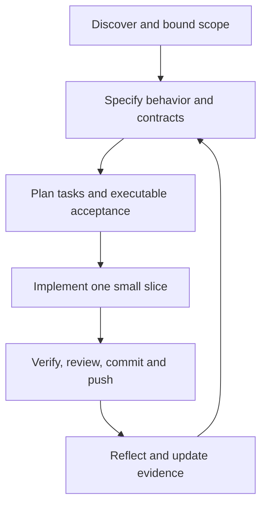

# An Experience Report on a Specification-Driven, AI-Assisted Software Construction Project

Campus Circle | SWCON2627 | 19 October 2026

**Review draft based on executed work.** Software, prompts, specifications, and test evidence are supplied. Team details, personal reflections, stakeholder acceptance, and manual browser review require student input before submission. AI authorship is disclosed throughout.

## Team Details

| Field | Information |
|---|---|
| Team number/name | Student to complete |
| Student name(s) and ID(s) | Student to complete; omitted from the public repository |
| Actual human roles and contribution percentages | Student to complete from real participation; no percentages invented |
| AI assistance | Codex desktop: implementation, specification drafting, tests, documentation, and automated audit |

The connected GitHub account is Tobbarin. Remote connector commits are attributed through that account, while their contents were generated by the AI agent. That attribution must not be presented as evidence that a student independently wrote the code. No other team member's contributions were simulated.

## Executive Summary

Campus Circle is a small social website for a conceptual student community. Visitors can register, log in, log out, read a public feed, and publish text posts after authentication. Two independently written Python implementations provide the same core behavior and share visual CSS and an external acceptance-test harness. SQLite persists accounts, sessions, and posts. Neither version is presented as a production service.

The first implementation used feature-first vibe coding: the agent built a running page, added authentication, added posting, and refined the result through tests and review. The second used an adapted GitHub Spec Kit 0.12.11 workflow. A constitution, prioritized user scenarios, numbered requirements, data model, HTTP contracts, implementation plan, task list, and verification mappings were committed before its application code. These are semi-formal specifications; mathematical proof was not performed.

Codex desktop provided AI assistance, and the GitHub connector published real incremental commits. The precise serving model identifier was not independently verified, so the report does not invent one. Verification combined shared HTTP acceptance tests, source review, and actual subprocess-restart and local response-time probes. Each final implementation passed 22 acceptance tests. Both preserved data and sessions across restart and met the local median-response target with 100 posts.

The exercise exposed a malformed-CSRF defect and several tooling limitations. It demonstrates the usefulness of explicit contracts and traceability, but cannot isolate SDD's causal effect because the second build benefited from prior learning. Human acceptance and visual browser review remain unverified, and personal reflections must be supplied by the students.

## 1. Introduction & Paradigm Shift

### 1.1 Project Overview & Objectives

The project compares two development approaches on a deliberately bounded system. Campus Circle offers account registration, login/logout, public reading, and authenticated publication. It avoids features such as uploads and private messaging so that both versions can be completed and compared within a limited timeline. The objectives are functional parity, reproducible execution, authentic process evidence, and a critical comparison supported by observed results.

### 1.2 The Vibe Coding Approach

Here, vibe coding means directing an AI agent through short feature-oriented natural-language instructions, inspecting the resulting behavior, and refining it. It did not mean deliberately omitting security or verification. The agent first produced the page, then accounts, then the feed. Tests and review followed each feature slice. Formal numbered specifications were not the source of truth for this first implementation.

### 1.3 The SDD Methodology

SDD treats explicit specifications and acceptance criteria as the source of truth for implementation. GitHub Spec Kit was chosen because it provides structured scaffolding for constitutions, specifications, plans, tasks, and verification. The official 0.12.11 package was actually installed and initialized with the Codex integration; the report does not merely label handwritten notes as toolkit execution.

The adapted workflow was constitution -> specify -> plan/contracts -> tests/tasks -> implement slices -> verify/converge. The agent read the installed specification/planning guidance and executed the setup-plan PowerShell script. Artifacts were written directly in this chat; no separate slash-command dispatch or autonomous specification model run is claimed. All work recorded here occurred on 19 October 2026. The vibe build was completed before SDD source began, with later shared boundary refinements disclosed.

## 2. Requirements & System Specification

### 2.1 Stakeholders

Prospective student visitors need readable updates without registering. Registered members need reliable identity and posting. The student development team needs a maintainable, reproducible prototype and an auditable comparison. Course assessors need authentic prompts, specifications, results, and version history. These are reasoned stakeholder categories, not evidence of interviews or actual university endorsement.

### 2.2 Functional Requirements

Functional requirements state services the system must provide. The SDD baseline numbers five groups: FR01 registers validated accounts; FR02 authenticates and invalidates sessions; FR03 reads the newest 100 persistent posts; FR04 publishes validated posts only for authenticated members; FR05 rejects invalid forms without changing account/post records and redirects successful submissions home.

Usernames contain 3-24 ASCII letters, digits, or underscores and are unique regardless of ASCII case. Display names contain 1-50 trimmed characters. Passwords contain 12-128 characters and preserve whitespace. Posts contain 1-500 Unicode code points after trimming. The server derives authorship from the session. Visitors can read all posts on this local instance; there is no private audience model.

### 2.3 Non-Functional Requirements

Non-functional requirements constrain quality and operation. Security requirements cover salted password derivation, opaque expiring sessions, CSRF protection, escaping, parameterized SQL, and authentication throttling. Usability requires labels, focus styles, understandable errors, and a responsive layout, with manual review still pending. Reliability requires persisted committed data and repeatable tests. Portability targets Python 3.12+ with no application dependencies. The performance target is a median home-page response below two seconds across 20 sequential local requests with 100 stored posts.

Neither the local performance target nor the security checks establish internet-scale availability, a compliance certification, or production readiness. HTTPS, Secure cookies, a hardened serving stack, operational controls, moderation, and retention decisions remain outside this prototype.

### 2.4 Technology Stack

Python's standard library minimizes installation overhead. SQLite supplies transactional persistence and uniqueness/foreign-key constraints. HTML forms allow the complete core interaction without JavaScript, and CSS supplies the shared visual design. The tradeoff is a deliberately local standard-library HTTP server. Vibe code is primarily one application module; SDD separates domain/persistence, rendering, and HTTP orchestration.

Codex desktop was the coding agent and documentation environment. The GitHub connector wrote incremental remote commits. Spec Kit 0.12.11 was development tooling only; its dependencies are not needed to run either app. The serving model's precise identifier was not independently established.

### 2.5 Interface & API Specifications

The interface consists of the public home/feed, registration form, login form, authenticated composer, and logout action. GET /, /register, /login, and /style.css serve the relevant resources. POST /register, /login, /logout, and /posts perform mutations. Successful forms return 303 to /. Invalid values return 400, wrong credentials or anonymous posting 401, CSRF failure 403, unknown routes 404, duplicate username 409, oversized or invalid-length requests 413, unsupported media type 415, and throttled authentication 429.

Requests use UTF-8 form encoding, an 8192-byte limit, at most ten fields, and no repeated keys. Every POST requires a session-bound token. Sessions expire after eight hours, rotate on successful authentication, and are removed on logout. The detailed contract and requirement mappings are versioned in sdd/specs/001-campus-circle/contracts/http.md. These are HTML-form endpoints, not an invented JSON REST API.

### 2.6 Deriving Requirements and Specifications

The user supplied the basic social functions and the two-method comparison. The Moodle brief supplied the report and evidence expectations. The agent derived concrete validation boundaries, security invariants, assumptions, and acceptance cases, recorded them in the Spec Kit project, and committed them before SDD code. Ambiguities were resolved with explicit bounded assumptions. No stakeholder interviews, formal approval, or human review are claimed.

## 3. Vibe Coding and the Project

### 3.1 Prompting Framework

The framework was feature decomposition followed by executable feedback. Each slice had a concrete output: a page, authentication, a feed, or a regression fix. The agent performed the work sequentially; there were no separate team coding modules or delegated agents. The visible decision records explain implementation choices without inventing hidden reasoning transcripts.

### 3.2 Master Prompts / System Prompts

The original user request required a social website twice, vibe first and SDD second, with small incremental pushes. Its task-bearing text is preserved in evidence/prompts.md as P001. No custom user-authored master system prompt was supplied. V001-V005 are explicitly agent-authored implementation instructions, rather than fictional user interactions.

Representative V002 instruction: "Add server-persisted registration, login, and logout to the existing shell." It further required password hashing, opaque sessions, CSRF, validation, and throttling. Expected output was working identity management before posting; the initial eight HTTP cases passed after a test-directory problem was corrected. V003 then required validated publication, escaped user content, server-derived author identity, and a bounded persistent feed. Fourteen HTTP cases passed at that stage.

### 3.3 Prompt Iteration Log

| Iteration | Expectation / observed issue | Refinement and outcome |
|---|---|---|
| V001 | Running page; external HTTP probe blocked | Network access granted; HTTP harness later verified responses. Browser preview still timed out. |
| V002 | Reproducible account tests; eight setup errors in sandbox temp directory | Place isolated databases in ignored workspace data directory; eight tests passed. |
| V004 | Controlled rejection of malformed CSRF | A15 reproduced TypeError for non-ASCII input; require a 64-character hex token before constant-time comparison; 18 tests passed. |
| V005 | Explicit shared request boundaries | Reject repeated form keys and NUL content, parse encoded UTF-8 strictly; expanded suite reached 22 passes. |

The TypeError is a concrete application failure. Temporary-directory permissions and a rejected file-edit patch were tooling issues. Distinguishing these prevents an inflated defect count. No plaintext-password failure or hallucinated dependency was invented to fit the course example.

## 4. Specification Driven Development and the Project

### 4.1 SDD Tool-kit

The official specify-cli 0.12.11 package was installed from PyPI. Initialization generated Codex skills, templates, PowerShell scripts, and workflow scaffolding. The setup-plan script returned the active feature paths successfully. Authored artifacts and toolkit version state are committed; upstream generated tooling is ignored and reproducible through the pinned installation command. See sdd/tooling.md for actual execution and the adaptation boundary.

### 4.2 Development Environment

The environment was Windows, PowerShell, Codex desktop, Python 3.12.14, and SQLite. Available bundled runtimes avoided application package setup. The local Git credential helper failed to start, so the authenticated GitHub connector published through GitHub's APIs. This was a publication transport change, not a reason to fabricate pushes or defer them until everything was finished.

### 4.3 Deriving Requirements with the Coding Agent

S001 instructed the agent to use installed Spec Kit scaffolding to define equivalent user stories, requirements, a constitution, state transitions, HTTP contracts, plans, tasks, and test mappings before independent source. The constitution required equivalent scope, explicit evidence, no copying of vibe Python, and truthful authorship. Security and quality requirements were made verifiable rather than phrased as vague goals such as "secure" or "fast."

### 4.4 SDD Workflow and Implementation

The specification baseline commit f6a9ec3 preceded any SDD app.py. Running the SDD test selection then failed at import because application source did not yet exist; this establishes a missing-implementation baseline, not 22 separately executed failing tests. The authentication slice implemented domain.py, views.py, and app.py and passed 14 selected cases before publication. The posting slice then passed all 22 cases and actual restart probes.

### 4.5 Prompts and Outcomes

S002 required implementing only the specified authentication slice in independent modules, using the shared CSS and harness as controls. Its expected output was contract-compliant authentication without copying vibe Python; selected tests passed. S003 required FR03/FR04 publication and feed behavior, followed by the full suite and restart/performance probes; all passed. No additional SDD application failure was observed in those executions. This result cannot establish that SDD prevents bugs, because the same agent already knew the first build's defects.

## 5. Verification and Validation

### 5.1 V&V Strategy

Verification combined actual HTTP requests, SQLite record inspection, source audit, and restarting real subprocess servers against the same database. The harness isolates each case. Shared assertions support behavioral comparison; they do not prove identical source or complete correctness. SDD mapped requirements to tests before its implementation. Vibe tests followed feature creation and review. Human-in-the-loop acceptance is still required and is not represented as completed.

Threats to validity include one small application, one AI agent, fixed development order, transferred learning, reused tests/CSS, no independent reviewer, no measured construction-time baseline, and no completed browser/accessibility review. Security tests cover selected attacks, not a penetration-test certification. No code-coverage percentage was measured.

### 5.2 Code Audit Log

| Finding | Resolution / limit |
|---|---|
| Non-ASCII CSRF caused a request-thread TypeError in vibe | Reproduced by A15, then fixed with format validation; SDD contract includes this requirement from the outset. |
| Ambiguous repeated fields and NUL content lacked explicit handling | Shared contract refinement and tests A20/A22; both builds reject them. |
| SQLite context managers do not themselves close connections | Application contexts explicitly close. The separate benchmark seeding harness later needed the same correction for Windows cleanup. |
| Prototype lacks a production serving/TLS stack | Bound to loopback; documented rather than presented as fixed production deployment. |
| Browser preview timed out | Disclosed verification gap and supplied a human checklist; no fake screenshots. |

This was AI review plus automated execution. Student review must be added only if actually performed.

### 5.3 Test Execution Results

Final shared suite: **22 passed, zero failed, for each build**. Raw execution logs are in evidence/test-results-vibe.txt and evidence/test-results-sdd.txt. Earlier staged results and reproduced failures remain in evidence/verification.md.

| Test | Expected behavior | Vibe / SDD actual |
|---|---|---|
| A01 | Home 200; security headers and HttpOnly cookie | Pass / Pass |
| A02 | Register 303; rotate and invalidate old session | Pass / Pass |
| A03 | Case-insensitive duplicate registration 409 | Pass / Pass |
| A04 | Logout invalidation, case-insensitive login, hashed storage | Pass / Pass |
| A05 | Invalid registration 400 | Pass / Pass |
| A06 | Wrong credentials 401 | Pass / Pass |
| A07 | Missing CSRF 403 | Pass / Pass |
| A08 | Eleventh authentication attempt 429 | Pass / Pass |
| A09 | Persisted post visible to another visitor | Pass / Pass |
| A10 | Anonymous publication 401 | Pass / Pass |
| A11 | Empty/501-character rejected; 500 accepted | Pass / Pass |
| A12 | User HTML displayed escaped | Pass / Pass |
| A13 | Newest first; submitted author ignored | Pass / Pass |
| A14 | Token from another session rejected | Pass / Pass |
| A15 | Non-ASCII CSRF rejected without disconnect | Pass / Pass |
| A16 | 500 emoji characters accepted | Pass / Pass |
| A17 | Expired session cannot publish | Pass / Pass |
| A18 | Unknown page 404 | Pass / Pass |
| A19 | Oversize/media/invalid UTF-8 rejected | Pass / Pass |
| A20 | Repeated form keys rejected | Pass / Pass |
| A21 | Only newest 100 posts rendered | Pass / Pass |
| A22 | NUL-containing post rejected | Pass / Pass |

Actual process probes verified persisted posts, persisted sessions, and login after restart in both builds. With 100 stored posts and 20 sequential measured requests after warm-up, vibe's median was 2.761 ms (maximum 27.990 ms) and SDD's 2.939 ms (maximum 24.254 ms). Both met the 2000-ms median target. These loopback samples exclude production networks and browser rendering; the difference is too small and uncontrolled to support a performance ranking.

## 6. Project Management & AI Toolchain Workflows

### 6.1 Version Control & Prompt Integration

The repository is https://github.com/Tobbarin/SWCON2627. Each remote milestone was published before implementing the next. Messages link changes to P001, V001-V005, or S001-S003. Remote commits were created through the connector because shell Git authentication failed. Early local commits have different SHAs; remote history is the publication evidence.

| Remote prefix | Published milestone |
|---|---|
| 6f0875a | README bootstrap |
| 066f59e | Course requirements and scaffold |
| ca5b987 | Vibe running shell |
| 5843b41 | Vibe authentication |
| 2de5fc1 | Vibe posting/feed |
| 9f9ae78 | Vibe final review and malformed-CSRF fix |
| f6a9ec3 | SDD baseline and shared contract expansion, before SDD source |
| 81465da | SDD authentication |
| e54d30e | SDD posting/feed and restart evidence |

The final report/evidence publication follows these commits. There were no simulated GitHub issue discussions or extra contributors. The workspace excludes databases, runtime credentials, and generated toolkit dependencies. Automated checks are reproducible locally; no CI execution is claimed in this report.

### 6.2 Team Contribution Breakdown

The agent handled specification drafting, coding, test automation, audit, and documentation. The user selected the repository and authorized incremental publication. A student team must add its real distribution of specifying, prompting, auditing, and orchestration work. The AI cannot establish who participated outside this conversation or assign valid percentages on their behalf.

## 7. Reflections on Specification-Driven Development

### 7.1 Benefits of AI-Assisted SDD

The strongest demonstrated benefit was inspectability: a reviewer can connect FR04 to its contract, domain operation, and acceptance tests. Committing specifications first makes the development order verifiable. Separating layers makes security and persistence decisions easier to locate. These observations are supported by artifacts; no percentage speedup over manual coding is claimed because manual effort was not measured.

### 7.2 Bottlenecks and Challenges

Authentication setup and sandbox file/network constraints interrupted work independently of methodology. A package could not be executed with python -m because it lacked __main__; the agent used the installed entry point instead. Toolkit templates do not establish correctness by themselves: meaningful requirements, executed tests, and truthful status still required work. The second implementation also inherited explicit knowledge of the first one's malformed-CSRF defect, which limits claims about SDD's superiority.

### 7.3 Lessons Learned & Best Practices

Both approaches reached the same 22-case result. Vibe coding quickly organized work around visible features, but its CSRF handling needed a concrete regression fix. SDD made transitions and request boundaries explicit before implementation. The evidence supports using specifications to improve traceability and reduce ambiguity, while retaining executable feedback for both methods.

Future teams should keep the observable scope fixed, log real prompts immediately, distinguish user instructions from agent decomposition, specify error paths alongside success paths, test malicious/malformed inputs, separate harness failures from application defects, and push real milestones. They should also schedule human browser review and avoid inventing failures, coverage, timing improvements, or contributions to make the report appear stronger.

Student reflection still needed: describe what the students personally learned, reviewed, changed, or found difficult. The observations above are the AI agent's evidence-based account, not a fabricated first-person student narrative.

### 7.4 Proposed Reusable SDD Workflow

| Phase | Inputs and activities | Output / oversight |
|---|---|---|
| Discover | User brief; bound scope, stakeholders, assumptions | Human-reviewed scope and exclusions |
| Specify | Scope; derive scenarios, requirements, states, errors | Versioned specification/contracts; human resolves important ambiguity |
| Plan and test | Specification; choose stack, map acceptance cases, create missing-implementation baseline | Tasks and executable verification; AI assists, reviewer checks traceability |
| Implement slices | Approved baseline; generate a small functional slice | Reviewed code; bounded vibe exploration can inform a draft, then update contracts deliberately |
| Verify and publish | Slice; execute tests, audit security, inspect browser behavior | Real results, fixes, milestone commit and push |
| Reflect and maintain | Evidence and feedback; compare assumptions with outcomes | Updated specifications, honest limitations, and next iteration |

This workflow incorporates the useful speed of feature exploration while requiring explicit contracts before committed implementation, regression tests for observed defects, and human acceptance before claiming user success. The malformed-CSRF regression justifies boundary tests; the Spec Kit baseline commit justifies versioned design gates; the browser timeout justifies distinguishing automated verification from user validation.

## References and Evidence

- User-supplied Moodle MHTML, "Description of the course project report," snapshot saved 19 October 2026; assignment text extracted into evidence/course-brief.md.
- Official GitHub Spec Kit repository: https://github.com/github/spec-kit.
- Official installation guidance: https://github.github.io/spec-kit/installation.html.
- Authored SDD baseline: sdd/specs/001-campus-circle/ and sdd/.specify/memory/constitution.md.
- Prompt, milestone, audit, raw-test, and runtime-metric records: evidence/.
- Human acceptance tasks: evidence/manual-review.md.
